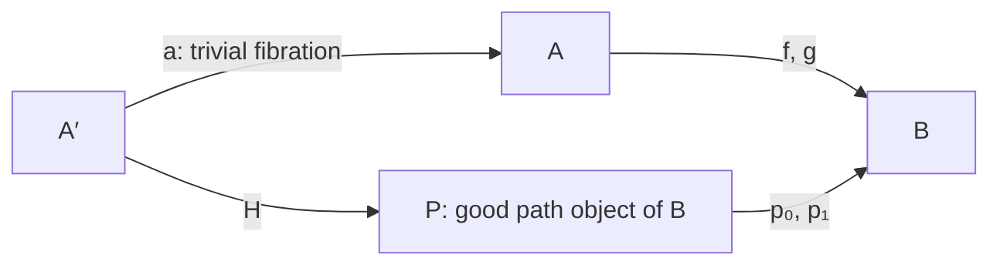

# Path objects and right homotopy

The implementations are [PathObject.lean](../../ABCCofibrations/PathObject.lean)
and [RightHomotopy.lean](../../ABCCofibrations/RightHomotopy.lean).

## Differences from the paper and duality

We use the paper's path objects of Definition 1.5.1(2) and the right-homotopy
relation of §6.3. Mathlib's `PathObject B` stores the path object and its
weak-equivalence inclusion; `PathObject.IsGood` supplies the fibration to
$B\times B$. Thus a path object in the paper corresponds to a good path
object in mathlib. Our homotopy data are mathlib's `PathObject.RightHomotopy`.
No model-category axioms are assumed.

Our prefibration axioms already mean CF1–CF4 on the opposite category.
Their native F3 and F4 consequences were proved by duality. At this stage
we use those consequences to construct native mathlib path objects and
prove their elementary properties, rather than identifying a native path
object with an opposite cylinder by definition. This avoids silently
identifying independently chosen products with opposite coproducts.
The explicit comparison is now proved in
[HomotopyOpposite.lean](../../ABCCofibrations/HomotopyOpposite.lean),
and transfers the larger existing homotopy proofs.

We choose a good path object for strict right homotopy. General right
homotopy permits a trivial fibration of the source, exactly as in the paper.
We do not replace this relation with mathlib's unrestricted path-homotopy
relation, which allows path objects without the goodness condition.

## Restricted products and good path objects

For fibrant $A,B$, the product is the pullback of $A\to\top\leftarrow B$.
It exists by the restricted F3 axiom. Both projections are fibrations, so
the product is fibrant. We require only these products, not all products
in the ambient category.

For fibrant $B$, apply F4 to the diagonal to obtain

$$
B\xrightarrow[\sim]{\iota}P\xrightarrow{(p_0,p_1)}B\times B,
\qquad \iota p_0=\iota p_1=1_B.
$$

Here and below adjacent morphisms in equations are composed in diagrammatic
order. This gives Lemma 1.5.2(2). Both $p_0$ and $p_1$ are fibrations by
composition with the product projections, and weak equivalences by two out
of three. The object $P$ is fibrant. Swapping the two projections preserves
goodness, using the product's symmetry isomorphism.

## The native homotopy relations

A strict right homotopy between $f,g:A\to B$ consists of a good path object
of $B$ and $H:A\to P$ with $Hp_0=f$, $Hp_1=g$.

General right homotopy consists of a trivial fibration $a:A'\to A$ and a
strict right homotopy between $af$ and $ag$:

The two equations are $Hp_0=af$ and $Hp_1=ag$.
Both relations are reflexive (for general right homotopy, the source is
fibrant) and symmetric. Strict right homotopy admits precomposition by any
map. General right homotopy admits precomposition from a fibrant object:
pull back $a$ along that map. F3 makes the new projection a trivial
fibration, while the other projection pulls back the strict homotopy.
Right-homotopic maps are weak equivalences simultaneously.

## Opposite comparison and Theorem 6.3.1(2)

`oppositeCoprodProductIso` identifies the unopposite of any chosen coproduct
of $B^{op}$ with the chosen native product $B\times B$. Its maps are built
from the universal projections and inclusions. The comparison is an
isomorphism, not a definitional identification of choices.

A native path object gives a cylinder on $B^{op}$ by reversing all arrows;
an opposite cylinder similarly gives a native path object. The comparison
isomorphism identifies their boundary maps. Composing with it or its inverse
preserves the required fibration/cofibration condition. Thus goodness, strict
homotopy, and general homotopy correspond exactly under opposites.

Transitivity of both right-homotopy relations and postcomposition of general
right homotopy now follow from the left-side theorems. In particular both
relations are equivalence relations in their stated fibrancy scope.
For any localization $L$, maps between fibrant objects satisfy

$$
L(f)=L(g)\quad\Longleftrightarrow\quad f\simeq_r g.
$$

This is Theorem 6.3.1(2), transported from the cofibrant localization equality
criterion on the opposite category. No reflection of ambient weak
equivalences by localization is assumed.

**Difference from the paper:** the paper states the dual theorem without
repeating the proof. We implement that duality explicitly, including the
chosen product/coproduct comparison, and reuse our existing cofibration-side
proofs. The native transitivity, postcomposition, and localization criterion
choose opposite coproducts internally, so callers need only the native
products required by their homotopy relations. The initial right-side fraction results are described below.

## Lean correspondence

All declarations below are in `ABCCofibrations.ABCPrefibrationCategory`.

| Statement | Declaration |
| --- | --- |
| Products of fibrant objects | `hasBinaryProduct`, `prod_fibrant` |
| Product projections are fibrations | `fibration_prod_fst`, `fibration_prod_snd` |
| Good path objects exist | `exists_good_pathObject` |
| Path projections are trivial fibrations | `fibration_pathObject_p₀`, `fibration_pathObject_p₁`, `weakEquivalence_pathObject_p₀`, `weakEquivalence_pathObject_p₁` |
| Path object is fibrant | `pathObject_fibrant` |
| Reversal preserves goodness | `good_pathObject_symm` |
| Strict right homotopy | `StrictRightHomotopyRel` |
| Strict reflexivity, symmetry, precomposition | `StrictRightHomotopyRel.refl`, `.symm`, `.precomp` |
| Right homotopy | `RightHomotopyRel` |
| General reflexivity, symmetry, precomposition | `RightHomotopyRel.refl`, `.symm`, `.precomp` |
| Weak-equivalence invariance | `StrictRightHomotopyRel.weakEquivalence_iff`, `RightHomotopyRel.weakEquivalence_iff` |

Additional names in `ABCCofibrations.ABCPrefibrationCategory`:

| Statement | Declaration |
| --- | --- |
| Opposite coproduct versus native product | `oppositeCoprodProductIso` |
| Path/cylinder data conversion | `pathObjectOp`, `cylinderUnop` |
| Goodness comparison | `pathObjectOp_isGood_iff`, `cylinderUnop_isGood` |
| Homotopy comparison | `strictRightHomotopy_iff_op`, `rightHomotopy_iff_op` |
| Transitivity | `StrictRightHomotopyRel.trans`, `RightHomotopyRel.trans` |
| Postcomposition | `RightHomotopyRel.postcomp` |
| Equivalence relations | `StrictRightHomotopyRel.equivalence`, `RightHomotopyRel.equivalence` |
| Theorem 6.3.1(2) | `ambient_map_eq_iff_fibrant_rightHomotopy` |

## Cancellation and initial fraction results

[RightHomotopyCancellation.lean](../../ABCCofibrations/RightHomotopyCancellation.lean)
transports the weak-equivalence cancellation results of 6.4.3(1)(b) to
6.4.3(2)(b). Precomposition and postcomposition by weak equivalences between
fibrant objects preserve and reflect right homotopy. The precomposition
reflection also works when the domain of the weak equivalence is not
fibrant. In particular, equality after such an ambient weak equivalence
implies right homotopy. These are direct uses of the opposite comparison,
not separate proofs of the homotopy-extension constructions.

[RightHomotopyFractions.lean](../../ABCCofibrations/RightHomotopyFractions.lean)
proves 6.4.4(2)(a), with the stronger trivial-fibration denominator. For any
localized arrow $\alpha:L(A)\to L(B)$ between fibrant objects there are
fibrant $Z$, a trivial fibration $s:Z\to A$, and $f:Z\to B$ such that

$$
L(s)\,\alpha=L(f).
$$

If two fractions share a weak-equivalence denominator $s:Z\to A$, with
$Z,B$ fibrant, their values agree exactly when their numerators are right
homotopic. This common-denominator criterion does not require $A$ fibrant,
or require the denominator to be a fibration.

**Differences from the paper:** cancellation and representation are obtained
by applying the existing left-side statements to opposite arrows and then
translating the result back to native objects. The representation strengthens
the denominator to a trivial fibration, as the dual of our previously proved
left-side result. The common-denominator criterion is an intermediate API;
it is not the full criterion allowing different denominators in 6.4.4(2)(b).
The general criterion and the full-boundary strengthening 6.4.5(2) are
now proved below.

| Statement | Declaration in `ABCCofibrations.ABCPrefibrationCategory` |
| --- | --- |
| Ambient precomposition cancellation | `RightHomotopyRel.of_precomp_weakEquivalence` |
| Ambient precomposition equality implies homotopy | `RightHomotopyRel.of_precomp_weakEquivalence_eq` |
| Postcomposition cancellation | `RightHomotopyRel.of_postcomp_weakEquivalence` |
| Preservation and reflection | `RightHomotopyRel.precomp_weakEquivalence_iff`, `RightHomotopyRel.postcomp_weakEquivalence_iff` |
| Right-fraction representation | `exists_ambient_trivialFibration_fraction` |
| Equality with a common denominator | `ambient_common_rightFraction_eq_iff_rightHomotopy` |

## Different denominators and the full-boundary refinement

For weak equivalences $s:Z_1\to A$, $t:Z_2\to A$ and numerators
$f:Z_1\to B$, $g:Z_2\to B$, with all four objects fibrant, let their
localized values be $\alpha,\beta$. Theorem 6.4.4(2)(b) is now proved:
these values agree exactly when there are fibrant $P$ and weak equivalences
$i:P\to Z_1$, $j:P\to Z_2$ such that

$$
is\simeq_r jt,\qquad if\simeq_r jg.
$$

The localized values are specified by the equations
$L(s)\alpha=L(f)$ and $L(t)\beta=L(g)$, so no particular implementation
of formal right-fraction evaluation is required by the interface.

For trivial-fibration denominators $s,t$, Theorem 6.4.5(2)(b) sharpens this:
the comparison maps $i,j$ can be trivial fibrations, with $is=jt$ exactly
and $if\simeq_r jg$. Only a binary product of $B$ with itself is needed
to express the remaining homotopy.

Theorem 6.4.5(2)(a) also strengthens representation: the numerator $f$,
denominator $s$, and full boundary $(f,s):Z\to B\times A$ can all be
fibrations, while $s$ remains a weak equivalence. The theorem accepts any
chosen product $B\times A$. We compare it explicitly with the unopposite
of the chosen coproduct of $B^{op},A^{op}$, using
`oppositeCoprodProductIsoPair`. The order $(f,s)$ follows the order of the
opposite numerator and denominator.

**Differences from the paper:** these results are direct transports of the
already proved left-side theorems. The proof temporarily bundles opposite
objects as mathlib cofibrant objects, then returns native objects, maps,
fibrancy, and right homotopies. The evaluation interface uses the numerator
and denominator equations instead of a new right-fraction structure. This
changes packaging only. The general criterion retains homotopy in both
triangles; the sharper criterion uses exact equality only under the stated
trivial-fibration assumptions. No saturation or weak-equivalence reflection
hypothesis is added.

| Statement | Declaration in `ABCCofibrations.ABCPrefibrationCategory` |
| --- | --- |
| Mixed product/coproduct comparison | `oppositeCoprodProductIsoPair` |
| Theorem 6.4.4(2)(b) | `ambient_rightFraction_eq_iff_exists_rightHomotopy` |
| Theorem 6.4.5(2)(a) | `exists_ambient_fibration_fraction_with_prod` |
| Theorem 6.4.5(2)(b) | `ambient_trivialFibration_fraction_eq_iff_exists_rightHomotopy` |

With the localization equality criterion `ambient_map_eq_iff_fibrant_rightHomotopy`
from the opposite comparison, the statements of 6.4.4(2) and 6.4.5(2)
are now proved. The native quotient category of fibrant objects by right homotopy and its
right calculus of fractions are now packaged below.

## The native quotient and its right calculus of fractions

[RightHomotopyCategory.lean](../../ABCCofibrations/RightHomotopyCategory.lean)
defines the native quotient of mathlib's `FibrantObject C` by right homotopy,
using mathlib's category quotient. Homotopy is a congruence, and equality of
the images of two arrows is exactly right homotopy. Each quotient arrow has
a representative. Weak equivalences descend because right-homotopic maps
are weak equivalences simultaneously.

[RightHomotopyWeakEquivalences.lean](../../ABCCofibrations/RightHomotopyWeakEquivalences.lean)
proves identities, composition, and two out of three for this descended
class, by choosing representatives. No saturation assumption is involved.

[RightHomotopyCategoryOpposite.lean](../../ABCCofibrations/RightHomotopyCategoryOpposite.lean)
constructs an equivalence

$$
\pi_r(\mathcal C_{fib})\simeq
  \bigl(\pi_l((\mathcal C^{op})_{cof})\bigr)^{op}.
$$

It sends a fibrant object to its cofibrant opposite object and reverses
representative arrows. The homotopy comparison proves faithfulness;
surjectivity on representative arrows proves fullness; the fibrant/cofibrant
object bridge proves essential surjectivity. This equivalence preserves
and reflects the descended weak equivalences.

[RightHomotopyOre.lean](../../ABCCofibrations/RightHomotopyOre.lean)
transports the strict Ore square of 6.4.3(1)(a) into the native statement
6.4.3(2)(a). A cospan $A\xrightarrow{f}B\xleftarrow[\sim]{b}B'$ of
fibrant objects admits fibrant $A'$, a weak equivalence $a:A'\to A$,
and $d:A'\to B'$ with $db$ strictly right homotopic to $af$.
On the quotient this is an honest commutative square. The extensionality
axiom uses postcomposition cancellation, with an identity as the new
denominator. Together with multiplicativity, this gives mathlib's
`HasRightCalculusOfFractions` for the native quotient weak equivalences.

**Differences from the paper:** the quotient is the native quotient on
fibrant objects, not a definition by an opposite category. Its comparison
with the opposite left quotient is proved afterward. The calculus is
recorded in mathlib's general Gabriel–Zisman interface (the infrastructure
for the simplified right calculus of Theorem 6.4.2). Its Ore proof reuses
the earlier opposite cylinder construction, while the quotient and
representative arguments are native. Combined with the previously proved
cancellation statements, the fibration-side statements in 6.4.3(2) are now
proved. We do not assert that the quotient itself is already a localization:
its weak equivalences still need to be inverted. That localization is now compared with fibrant-object and ambient
localizations below.

All new names below are in `ABCCofibrations.ABCPrefibrationCategory`.

| Statement | Declaration |
| --- | --- |
| Native relation on fibrant objects | `fibrantRightHomotopyRel` |
| Native quotient and projection | `RightHomotopyCategory`, `toRightHomotopyCategory` |
| Equality iff right homotopy | `toRightHomotopyCategory_map_eq_iff` |
| Representative weak equivalences | `weakEquivalence_toRightHomotopyCategory_map_iff` |
| Opposite quotient equivalence | `rightHomotopyCategoryOppositeEquivalence` |
| Preservation and reflection of weak equivalences | `weakEquivalence_rightHomotopyCategoryToOpposite_map_iff` |
| Native strict Ore square | `exists_strict_right_homotopy_ore` |
| Right calculus of fractions | `weakEquivalences_rightHomotopyCategory_hasRightCalculusOfFractions` |

## Localization of the quotient and comparison with the ambient category

[RightHomotopyLocalization.lean](../../ABCCofibrations/RightHomotopyLocalization.lean)
first proves that every weak-equivalence-inverting functor on fibrant
objects identifies right-homotopic maps. For a strict homotopy, the weak
equivalence into its path object makes the two projections have equal
images. The trivial fibration changing the source can then be cancelled.
This yields a unique factorization through the native right-homotopy quotient.

Consequently, the quotient functor is a localized equivalence of localizers.
Localizing its source at weak equivalences before taking the quotient, or
localizing the quotient at its descended weak equivalences, gives equivalent
categories. We also construct the direct comparison from the quotient to
fibrant-object localization and prove its strict localization universal
property. In particular, this comparison is a localization functor.

The native fibrant inclusion is already a general fibrant approximation.
Its induced functor on canonical localizations is therefore an equivalence,
giving the native formulation of Theorem 6.1.6(2). Any ambient localization
restricts to a localization of fibrant objects. Composing these equivalences
gives

$$
\bigl(\pi_r(\mathcal C_{fib})\bigr)[W^{-1}]
\simeq \mathcal C_{fib}[W^{-1}]
\simeq \mathcal C[W^{-1}].
$$

**Differences from the paper:** the mathematical comparison is the dual of
the cofibration-side construction, with no extra axioms. We give a native
factorization/universal-property proof so the result applies directly to
mathlib's fibrant-object and quotient types. Mathlib's general theorem on
relations factoring through localization supplies the first equivalence;
the previously established general fibrant-approximation theorem supplies
the second. No second construction of object replacements is required.
The quotient itself is still distinguished from its localization.

| Statement | Declaration in `ABCCofibrations.ABCPrefibrationCategory` |
| --- | --- |
| Right homotopy is killed by any inverting functor | `map_eq_of_fibrant_rightHomotopy` |
| Unique factorization through the quotient | `liftFromRightHomotopyCategory`, `_fac`, `_unique` |
| Quotient as a morphism of localizers | `rightHomotopyQuotientLocalizerMorphism` |
| Fibrant-object versus quotient localization | `rightHomotopyLocalizationEquivalence` |
| Direct quotient comparison | `rightHomotopyCategoryToLocalization` |
| Its strict localization universal property | `rightHomotopyComparisonStrictUniversalProperty` |
| It is a localization | `rightHomotopyCategoryToLocalization_isLocalization` |
| Native fibrant inclusion comparison | `fibrantLocalizationToAmbient` |
| Theorem 6.1.6(2), native equivalence | `fibrantAmbientLocalizationEquivalence` |
| Restricting arbitrary ambient localization | `fibrantInclusion_comp_isLocalization` |
| Quotient localization versus ambient localization | `rightHomotopyAmbientLocalizationEquivalence` |

Faithfulness of the direct comparison and the equality criterion for any
fibrant-subcategory localization are now proved below. The ambient equality
criterion 6.3.1(2) was already proved by the opposite comparison.

## Faithfulness and equality in arbitrary fibrant-object localizations

A weak equivalence in the native quotient is an epimorphism: choose a
representative and cancel it from a right homotopy using the earlier
precomposition-cancellation theorem. Thus, if two quotient arrows become
equal under the direct comparison to fibrant-object localization, the
right calculus of fractions gives a weak-equivalence precomposition making
them equal already. That precomposition is an epimorphism, so it cancels.
The comparison is therefore faithful.

For any localization $F$ of the fibrant subcategory, and any native arrows
$f,g:X\to Y$, we now have

$$
F(f)=F(g)\quad\Longleftrightarrow\quad f\simeq_r g.
$$

Equality in $F$ transfers to equality in the canonical localization by the
localization universal property. Faithfulness of the quotient comparison
then gives equality of homotopy classes. Conversely, every functor inverting
weak equivalences identifies right-homotopic maps.

**Difference from the paper:** this is the native fibrant-subcategory form
of the equality criterion 6.4.4(2)(c), stated for any localization functor.
The ambient form was already proved. The proof mirrors the cofibration-side
argument, using epimorphisms and the right calculus in place of
monomorphisms and the left calculus. Faithfulness does not assert fullness
or identify the unlocalized quotient with the localization.

| Statement | Declaration in `ABCCofibrations.ABCPrefibrationCategory` |
| --- | --- |
| Weak-equivalence representatives give epimorphisms | `epi_toRightHomotopyCategory_map` |
| Any descended weak equivalence is an epimorphism | `epi_of_weakEquivalence_rightHomotopyCategory` |
| Faithfulness of the direct comparison | `rightHomotopyCategoryToLocalization_faithful` |
| Equality iff right homotopy for arbitrary fibrant localization | `map_eq_iff_fibrant_rightHomotopy` |

The next localization refinement is to invert only trivial fibrations on
fibrant objects and compare that construction with weak-equivalence
localization, using the already available Brown functor lemma.
