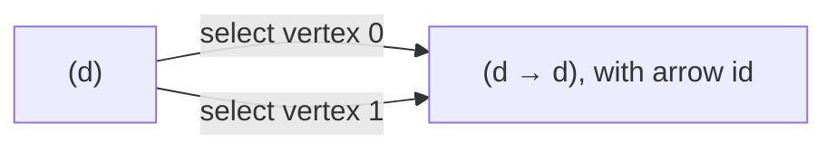

# The direct resolution of §9.5 and the initial-object obstruction

## Checked foundation

`SemisimplicialResolution.lean` constructs the category Δ′D of §9.5 of
*Cofibrations in Homotopy Theory*, math/0610009v4. Objects are finite nonempty
composable chains in D, including chains containing identity arrows. Maps are
injective order-preserving maps of indexing ordinals commuting with the labels.

The implementation reuses mathlib's `SemiSimplexCategory`, `nerve`, and category
of elements. It takes the opposite of the category of elements of the nerve
restricted to injective ordinal maps. The degree is the length of the simplex;
`resolution_isDirect` checks the direct-category axiom.

`resolutionTerminal` is the terminal projection pₜ. Its composition law and
`resolutionMap_terminal` check functoriality and naturality in D. The library
also supplies the labelled singleton, constant simplices, and a faithful functor
`resolutionConstants d` from Δ′ into Δ′D.

The native inverse resolution is constructed by duality from the direct
resolution of Dᵒᵖ, followed by taking opposites. `resolutionInitial` gives its
projection into D. This makes the variance of the inverse construction explicit.

No cofibration-category axioms are needed for these categorical constructions.
For `D : Type u` with morphisms in `Type v`, the resolution objects lie in
`Type (max u v)` and its morphisms are built from finite ordinal embeddings.

## Lemma 9.5.2(1)(a) cannot be used as stated

The paper claims that the fiber of pₜ over d has initial object the singleton
(d). Take D to be the terminal category. Its resolution is Δ′, the category of
all finite nonempty ordinals and injective order-preserving maps. There are two
maps from the one-vertex simplex to the two-vertex simplex:

Both maps project to the identity of d. Thus the problem occurs both for a
strict functor fiber (maps projecting to an identity) and for the full
subcategory on objects whose terminal label is d.

More strongly, every object of Δ′ has two distinct face inclusions into the next
ordinal, so Δ′ has no initial object at all.
`SemisimplexCounterexample.lean` proves:

- `semisimplex_parallel_maps` and `semisimplex_not_isInitial`;
- `resolutionFiber_constant_not_isInitial`, for the full inverse-image category;
- `terminal_resolution_not_isInitial`, for every object of the resolution of
  the terminal category `Discrete PUnit`.

`SemisimplexContraction.lean` also supplies an explicit categorical contraction
zigzag `id → semisimplexShift ← const [0]`. It adjoins a new first vertex.
Both arrows are checked natural transformations. We have not yet connected
this zigzag to a formal statement about the geometric realization of the nerve.

This refutes the initial-object assertion. It does not refute the assertion of
contractibility of the nerve, or the statement of Proposition 9.5.4.

The proof of Proposition 9.5.4 uses the asserted initial object to construct a
natural weak equivalence from a constant diagram and to prove that this constant
diagram is Reedy cofibrant. Merely replacing “initial object” by “contractible
nerve” does not justify either of those steps.

## A separate candidate repair

`ResolutionTerminalVertex.lean` constructs `TerminalVertexResolution d`:
mark the terminal vertex of a simplex by a map from the singleton (d), and
require maps to preserve this marking. It is a full subcategory of the under
category of the singleton, rather than a full subcategory of Δ′D.

`terminalVertexSingletonIsInitial` proves that the marked singleton is initial.
The marked category is now also checked to be direct, its terminal label is d,
and its markings give a natural map from the constant singleton diagram.
`ReedyConstantInitial.lean` proves that a constant diagram at a cofibrant object
is Reedy cofibrant on a direct category with an actual initial object, including
existence of its latching colimits. The marked category inherits this result.

However, `terminalVertexForget_not_final` in
`TerminalVertexCofinalityObstruction.lean` now proves that forgetting the marking
is not final: in the comma category under the singleton, whether a map equals
the marked inclusion is invariant under morphisms, and the two endpoint maps
into a constant edge give different values. This rules out the naive ordinary
cofinality continuation, including for the terminal input category.
A restricted homotopical comparison and the Reedy restriction theorem remain
unproved. The construction is therefore a partial repair with a checked
limitation, not a completed corrected proof of §9.5.

## Literature check (2026-11-20)

A search for the lemma number, the proposition number, and errata did not locate
an explicit published correction of Lemma 9.5.2. This is a bounded search result,
not a claim that nobody has noticed the issue.

[Tobias Lenz, *Homotopy (pre)derivators of cofibration categories and
quasicategories*, AGT 18 (2018), 3601–3646](https://msp.org/agt/2018/18-6/agt-v18-n6-p12-p.pdf),
Proposition 3.1(2), cites either Rădulescu-Banu 9.5.8(1), or Cisinski 6.17ᵒᵖ
and 2.5ᵒᵖ, for the comparison induced by the direct resolution. This is useful
for locating the relevant theorem, but Lenz does not discuss the initial-object
obstruction there.

[Denis-Charles Cisinski, *Catégories dérivables*, BSMF 138 (2010),
317–393](https://www.numdam.org/item/BSMF_2010__138_3_317_0.pdf), §§6.12–6.17,
uses the same direct resolution. Lemma 6.15 explicitly refers to Rădulescu-Banu
Proposition 9.5.4 for its proof, and Theorem 6.17 uses Lemma 6.15. Consequently,
that reference chain does not provide an independent proof repairing this gap.
Theorem 6.11 likewise cites Rădulescu-Banu 9.5.5.

[Karol Szumiło, *Two Models for the Homotopy Theory of Cocomplete Homotopy
Theories*, arXiv:1411.0303v1](https://arxiv.org/pdf/1411.0303v1), Lemma 3.9,
provides an explicit homotopy equivalence D[n] → [n]. It inserts additional
vertices to obtain a functor s and natural weak equivalences id → s ← fp.
For n = 0, this is a contraction of Δ′ and avoids any initial-object claim.
Lemma 3.13 uses a related append-a-vertex construction. These provide an
independent model for the categorical contraction, but are not stated as
corrections of Lemma 9.5.2. Their general use in our formalization requires
checking the Reedy and colimit hypotheses, rather than identifying a homotopy
equivalence of categories with an ordinary colimit-preservation statement.

The published version of the contraction is cited as Lemma 3.2 of Szumiło's
*Frames in cofibration categories* by Lenz (after Corollary 3.2) and by Szumiło,
[*Homotopy theory of cocomplete quasicategories*, AGT 17 (2017),
765–791](https://msp.org/agt/2017/17-2/agt-v17-n2-p06-s.pdf), proof of Lemma 3.5.
The complete proof inspected here is the accessible arXiv version above;
the numbering differs.

## Differences from the paper and outstanding work

The direct resolution and terminal projection implement the paper's objects and
maps, retaining degenerate simplices. The inverse construction makes the
opposite on the ambient category explicit so that its projection has codomain D.

We do not formalize the false initial-object assertion. The marked-terminal
category is explicitly a different category, and its initial object is a
separate checked result. No replacement for the full proof of Proposition 9.5.4
is claimed. `ResolutionVertexInsertion.lean` now checks the operation of appending an
explicit terminal label to a finite chain, using mathlib's `WithTerminal`.
The source correspondence for Lemma 9.5.1, the general labelled contraction,
and the restricted Reedy comparisons must be checked before advancing to the
arbitrary-indexing diagram-category theorem.

The dedicated survey [direct and filtered replacements](direct-and-filtered-replacements.md)
collects both routes, their limitations, and alternatives from subdivision,
simplicial replacement, bounded diagrams, and filtered indexing categories.
